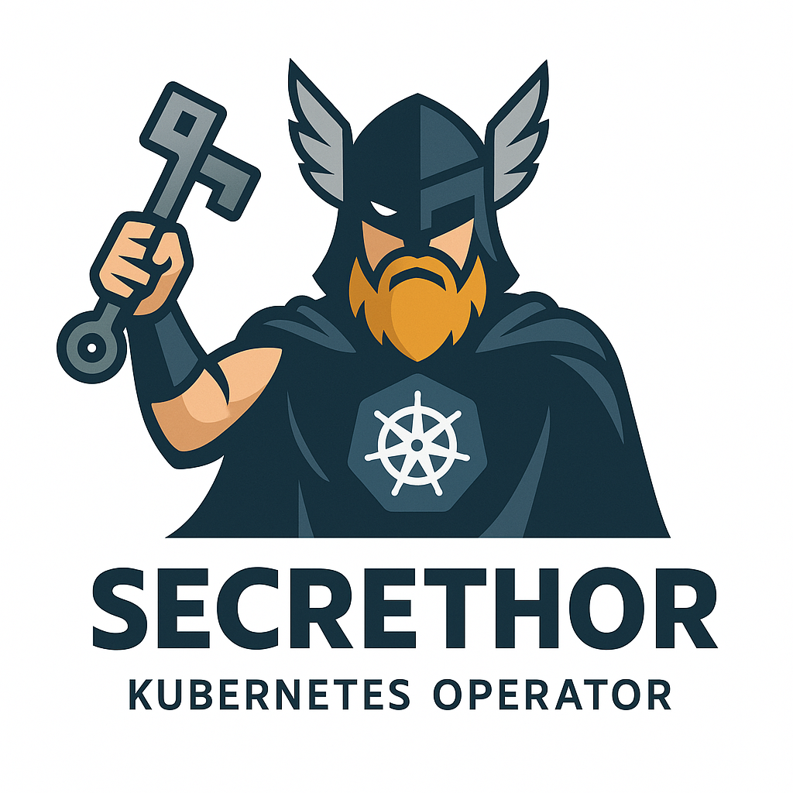

<p align="center">
  
</p>

<p align="center">
  <a href="https://www.apache.org/licenses/LICENSE-2.0"></a>
  <a href="https://goreportcard.com/report/github.com/miltlima/secrethor"></a>
  <a href="https://github.com/miltlima/secrethor/actions"></a>
  <a href="https://github.com/miltlima/secrethor/releases"></a>
  <a href="https://github.com/miltlima/secrethor/commits/main"></a>
  <a href="https://github.com/miltlima/secrethor/issues"></a>
  <a href="https://github.com/miltlima/secrethor/pulls"></a>
  <a href="https://github.com/miltlima/secrethor/stargazers"></a>
  <a href="https://github.com/miltlima/secrethor/network/members"></a>
  <a href="https://pkg.go.dev/github.com/miltlima/secrethor"></a>
  <a href="https://artifacthub.io/packages/helm/secrethor/secrethor"></a>
</p>

# Secrethor

**Secrethor** is a Kubernetes operator that audits the hygiene of your Secrets. It reads the Secrets in your cluster, compares them with the `SecretPolicy` resources you define, and reports what it finds. It never modifies a Secret, and by default it never blocks one.

It answers three questions:

- **Which Secrets are stale?** Data not rotated within `maxAgeDays`.
- **Which Secrets are unused?** Not referenced by any Pod, ServiceAccount or Ingress.
- **Which Secrets are out of standard?** Wrong type, missing or forbidden keys, weak values.

## 🚀 How it works

- **Audit (always on).** Every `SecretPolicy` is re-audited on an interval (15 minutes by default). Results go to the policy `status` and to Prometheus metrics. The operator only needs read access to Secrets, Pods, ServiceAccounts and Ingresses.
- **Admission webhook (optional).** When enabled, Secrets that break a policy get a warning at `kubectl apply` time. Policies with `enforcement: Enforce` reject them instead.

```console
$ kubectl get secretpolicies
NAME      MODE    AUDITED   VIOLATIONS   EXPIRED   UNUSED   LAST AUDIT
hygiene   Audit   42        3            7         5        2m
```

## 📋 Prerequisites

- Kubernetes cluster (v1.21+)
- Helm 3
- cert-manager, only if you enable the admission webhook
- Go (v1.23.0+) and Docker, only to build from source

## 🛠 Installation

### Using Helm (Recommended)

```bash
helm repo add secrethor https://miltlima.github.io/secrethor

helm install secrethor secrethor/secrethor \
  --namespace secrethor-system \
  --create-namespace
```

This installs the auditor only. Nothing is blocked and cert-manager is not needed.

#### Upgrading from an earlier version

Helm does not upgrade CRDs. Apply the new one before upgrading the chart:

```bash
kubectl apply -f https://raw.githubusercontent.com/miltlima/secrethor/main/charts/secrethor/crds/bases/customresourcedefinition-secretpolicies.secrets.secrethor.dev.yaml
```

Existing policies become `enforcement: Audit` and stop rejecting Secrets. Set `enforcement: Enforce` on the ones that must keep blocking.

#### Optional: enable the admission webhook

Requires cert-manager in the cluster.

```bash
helm upgrade secrethor secrethor/secrethor \
  --namespace secrethor-system \
  --set webhook.enabled=true
```

The webhook never applies to `kube-system` or to the namespace Secrethor runs in. With the default `webhook.failurePolicy=Fail`, Secret writes in other namespaces are rejected while the operator is unavailable; set it to `Ignore` if you only want warnings.

#### Chart values

| Value | Default | Description |
|---|---|---|
| `audit.interval` | `15m` | How often each policy is re-audited |
| `audit.maxFindings` | `100` | Findings kept in the status of each policy |
| `webhook.enabled` | `false` | Serve the admission webhook (requires cert-manager) |
| `webhook.failurePolicy` | `Fail` | What the API server does when the webhook is unreachable |

#### Uninstall

```bash
helm uninstall secrethor --namespace secrethor-system
```

### Manual Installation

```bash
# Deploys the operator with the webhook enabled (requires cert-manager)
make deploy IMG=docker.io/bonovoo/secrethor:latest

kubectl get pods -n secrethor-system
```

## 📝 Usage

### Audit the whole cluster

```yaml
apiVersion: secrets.secrethor.dev/v1alpha1
kind: SecretPolicy
metadata:
  name: hygiene
spec:
  allowedNamespaces: ["*"]
  maxAgeDays: 90
  detectUnused: true
```

### Read the findings

```bash
kubectl get secretpolicy hygiene \
  -o jsonpath='{range .status.findings[*]}{.reason}{"\t"}{.namespace}/{.name}{"\t"}{.message}{"\n"}{end}'
```

```text
Expired          payments/db-credentials   data last written 212 days ago, max allowed is 90
PolicyViolation  payments/legacy-api       key "token" is forbidden
Unused           staging/old-tls           not referenced by any Pod, ServiceAccount or Ingress
```

`status.summary` always counts every finding. `status.findings` is capped at `audit.maxFindings`, and `status.findingsTruncated` tells you when it was cut. Findings never include Secret values.

### Metrics

| Metric | Labels | Meaning |
|---|---|---|
| `secrethor_secret_findings` | `policy`, `namespace`, `reason` | Secrets with a problem; `reason` is `PolicyViolation`, `Expired` or `Unused` |
| `secrethor_secrets_audited` | `policy` | Secrets covered by the policy in its last audit |

### A stricter policy that blocks

```yaml
apiVersion: secrets.secrethor.dev/v1alpha1
kind: SecretPolicy
metadata:
  name: production-policy
spec:
  enforcement: Enforce   # requires webhook.enabled=true
  allowedNamespaces:
    - production
    - staging
  maxAgeDays: 30
  allowedTypes:
    - Opaque
    - kubernetes.io/basic-auth
    - kubernetes.io/dockerconfigjson
  requiredKeys:
    - username
    - password
  forbiddenKeys:
    - token
    - privateKey
  valueConstraints:
    password:
      minLength: 12
      mustContain:
        - upper
        - lower
        - number
        - special
    username:
      minLength: 4
      regex: "^[a-zA-Z0-9_.-]+$"
```

### Policy reference

| Field | Description |
|---|---|
| `enforcement` | `Audit` (default) only reports. `Enforce` rejects violating Secrets at admission. |
| `allowedNamespaces` | Namespaces the policy covers. `"*"` covers all of them. |
| `maxAgeDays` | Reports Secrets whose data was last written more than this many days ago. `0` disables the check. |
| `detectUnused` | Reports Secrets no Pod, ServiceAccount or Ingress references. |
| `allowedTypes` | Secret types that are accepted. |
| `requiredKeys` | Keys every Secret must have. |
| `forbiddenKeys` | Keys no Secret may have. |
| `valueConstraints` | Per-key rules: `minLength`, `mustContain` (`upper`, `lower`, `number`, `special`), `regex`. |

### Things to know

- **Age** is taken from the last write to the Secret data recorded by the API server, and falls back to the creation time.
- **Unused** only looks at Pods, ServiceAccounts and Ingresses. A Secret read through the API by an operator, or referenced only by a custom resource, is reported as unused. ServiceAccount tokens, bootstrap tokens and Helm release Secrets are never reported.
- **Expiry and unused are never enforced.** Only type, key and value rules can reject a Secret.
- **Enforce closes other namespaces.** While any policy enforces, Secrets in namespaces that no policy lists are rejected.

---

## 🗺 Roadmap

- [x] Expired secrets detection
- [x] Unused secret detection
- [x] Audit-only mode with status and metrics
- [ ] Usage detection through custom resources (Certificates, ExternalSecrets, ...)
- [ ] Exemptions by label or annotation
- [ ] Grafana dashboard and alert rules
- [ ] OLM/OperatorHub support

## 🤝 Contributing

We welcome contributions from the community! Here's how you can help:

1. Fork the repository
2. Create a feature branch (`git checkout -b feature/amazing-feature`)
3. Commit your changes (`git commit -m 'Add amazing feature'`)
4. Push to the branch (`git push origin feature/amazing-feature`)
5. Open a Pull Request

Please read our [Contributing Guidelines](CONTRIBUTING.md) for more details.

---

## License

Apache License - see LICENSE file for details.

---
Built with ❤️ by [Milton Lima de Jesus](https://github.com/miltlima)


